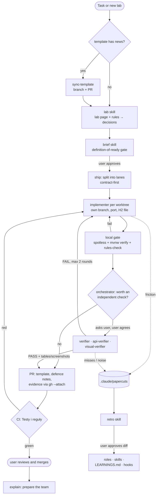

# Agentic workflow

How work gets done in this repo with Claude Code or Codex, and why it is set up this way.

## Why

A team of three, a graded lab every week, official rules in CI, and an instructor who may ask anyone to explain any line. So the setup needs:

1. **Isolation.** Work never lands on `main` directly; parallel agents never share a worktree.
2. **A human merge.** Agents open PRs; a person reviews and merges.
3. **Rules first.** The official rules decide the grade, so they are checked locally before every PR.
4. **Understanding.** Every PR explains how it works, and `explain` prepares each person for the defence.
5. **Memory.** A mistake made once should not be made again.

## Pipeline



## The pieces

| Piece | Where | Job |
| --- | --- | --- |
| `lab` skill | `.agents/skills/lab` | Reads a lab page and its rules, shows what is missing, asks the team the domain decisions, produces briefs. |
| `brief` skill | `.agents/skills/brief` | Writes `.agents/briefs/<slug>.md`. Nothing starts until it passes the definition-of-ready gate. |
| `ship` skill | `.agents/skills/ship` | The orchestrator: lanes, worktrees, gate, asks before verifiers, opens the PR, watches CI. Never merges. |
| `rules-check` skill | `.agents/skills/rules-check` | Runs the template's fresh rules for lab N in an isolated copy, like CI. |
| `sync-template` skill | `.agents/skills/sync-template` | Brings the instructor's template updates in through a branch and PR. |
| `explain` skill | `.agents/skills/explain` | Explains code in Polish, with likely instructor questions; quiz mode. |
| `retro` skill | `.agents/skills/retro` | Turns repeated papercuts into rule changes, with the user's approval. |
| `implementer` | `.agents/roles/implementer.md` | Builds one lane in its worktree; reports DONE (with defence notes) or BLOCKED. |
| `verifier` | `.agents/roles/verifier.md` | Optional, read-only: criteria → code + test, scope, package rules, JPA pitfalls, re-runs the gate. |
| `api-verifier` | `.agents/roles/api-verifier.md` | Optional: calls the running app's endpoints with curl, returns a table for the PR. |
| `visual-verifier` | `.agents/roles/visual-verifier.md` | Optional: Playwright MCP screenshots of pages for the PR. |
| Worktree scripts | `scripts/worktree-{new,remove}.sh` | One worktree per lane, own port (`8080 + 10 * slot`), own H2 file. |

Optional verifiers run only after the orchestrator asks and the user agrees.

## Guardrails

- **Git hooks** (`.githooks/`, enabled with `git config core.hooksPath .githooks`; Claude does it on session start): pre-commit blocks commits on `main`, pre-push blocks pushes to `main`.
- **GitHub branch rule** on `main`: changes only through PRs.
- **Claude hooks** (`.claude/settings.json`): a guard blocks `gh pr merge`, force-push and pushing to `main` (it checks command segments, so a heredoc line that itself starts with such a command is blocked too — write those files with the editor tool); every edited `.java` file is formatted with Spotless; a retro reminder appears when 3+ papercuts wait.
- **Codex hooks** (`.codex/hooks.json`): Spotless formatting after `apply_patch`, retro reminder. Merge and force-push bans are policy in `AGENTS.md` plus Codex's own approval prompts.
- **CI** ("Testy i reguły") runs `mvn verify` with the official rules on every PR.

## Self-improvement loop

1. **Capture.** Friction becomes one file in `.claude/papercuts/`, never an edit, so parallel sessions don't conflict.
2. **Remind.** Hooks remind when 3+ papercuts wait.
3. **Fold.** `retro` groups them by root cause and proposes the smallest fix; mechanical enforcement beats prose.
4. **Approve.** The user accepts, edits or rejects each diff.
5. **Prune.** `LEARNINGS.md` stays under ~60 lines.

## One-time setup

1. **JDK 21** (like CI); Spotless fails on newer JDKs. On macOS: `export JAVA_HOME=$(/usr/libexec/java_home -v 21)` for Codex and terminals. For Claude put it in the gitignored `.claude/settings.local.json`:
   ```json
   { "env": { "JAVA_HOME": "/path/to/jdk-21" } }
   ```
2. **Git hooks:** `git config core.hooksPath .githooks` (Claude sets it automatically).
3. **Claude Code:** start `claude` in the repo root and approve the `playwright` MCP server. Skills and agents load from `.claude/skills` and `.claude/agents`.
4. **Codex:** start `codex` in the repo root and trust the project (trust is local). Codex reads `AGENTS.md`, the skills in `.agents/skills/`, the agents in `.codex/agents/` and the MCP in `.codex/config.toml`. Open `/hooks` and trust the hooks.
5. **GitHub CLI:** `gh auth login`.
6. **Playwright:** on first use it may ask for `npx playwright install chromium`.

Teammates who only use IntelliJ need step 2 only, and work on branches with PRs like everyone else.
