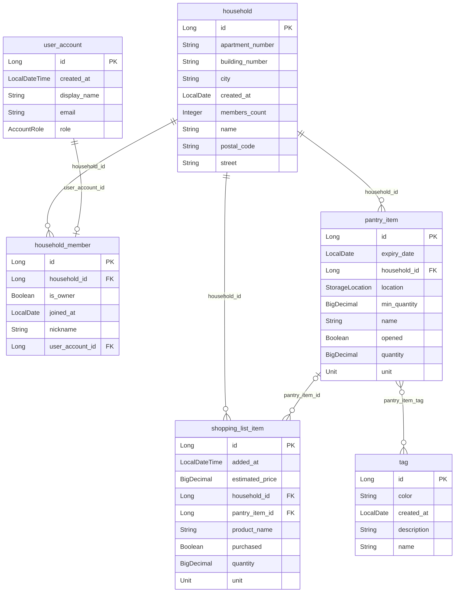

# Schemat bazy danych

Plik generują reguły projektu (panel Maven → Lifecycle → verify). Nie edytujcie go ręcznie.

Tabele: 7 (w tym tabele łączące @ManyToMany: pantry_item_tag) · kolumny: 43 · relacje: 4 × @ManyToOne, 1 × @OneToMany, 1 × @OneToOne, 1 × @ManyToMany

| Tabela | Encja | Kolumny | Klucze obce |
|---|---|---|---|
| household | Household | 9 | — |
| household_member | HouseholdMember | 6 | household_id, user_account_id |
| pantry_item | PantryItem | 9 | household_id |
| shopping_list_item | ShoppingListItem | 9 | household_id, pantry_item_id |
| tag | Tag | 5 | — |
| user_account | UserAccount | 5 | — |

